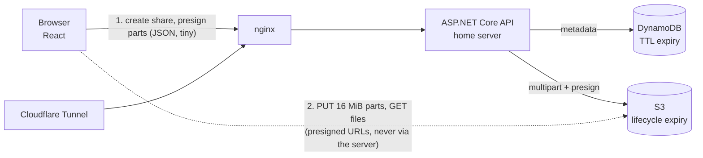

# NitroDrp

```
$ nitrodrp send --private
```

A private, self-hosted file transfer app: upload big files, get an unguessable link, set an expiry, an optional password and a download limit. Built to replace a WeTransfer subscription, and as a portfolio project.

**Stack:** ASP.NET Core 10 (minimal APIs) · React + TypeScript (Vite) · Amazon S3 · CloudFront · DynamoDB · Terraform · Docker Compose · Cloudflare Tunnel.

**Try it:** [portfolio demo](#portfolio-demo-and-embedding) (runs entirely in your browser).

## How it works



Design decisions worth knowing:

- **File bytes never touch the home server.** The API only signs URLs. Uploads are S3 multipart (16 MiB parts, 4 in flight, per-part retry with backoff and a fresh URL), so multi-GB files survive flaky connections and the home uplink isn't the bottleneck.
- **Uploads resume after a reload.** The browser remembers the unfinished share; re-picking the same files (matched on name, size and modified time) turns the button into "Resume upload". The API asks S3 which parts it holds (`ListParts`, so S3 is the source of truth) and only the missing parts are sent. S3 aborts abandoned uploads after 2 days, after which the page says so and starts fresh.
- **Expiry is enforced twice.** The API refuses expired links immediately; DynamoDB TTL deletes the metadata; S3 lifecycle rules (one per expiry choice, keyed on the `d<days>/` key prefix) delete the bytes. No cleanup cron.
- **Download limits are race-free.** The count is a single conditional `UpdateItem` (`downloadCount < downloadLimit`), so concurrent downloads can't exceed the limit. Covered by a concurrency test.
- **Downloads go through CloudFront, not S3.** S3 to CloudFront transfer is free and CloudFront's free tier covers 1 TB/month, so large galleries don't hit S3's $0.09/GB egress. The bucket stays private (origin access control); the API issues short-lived CloudFront signed URLs (RSA key you generate, public half in a Terraform key group). The download filename is part of the signed URL, so it can't be altered. If `CLOUDFRONT_DOMAIN` is unset (local MinIO), the API falls back to S3 presigned URLs behind the same `IDownloadLinkSigner` interface.
- **"Download all" is a streamed .zip.** The browser navigates to a short-lived HMAC-signed URL (the password was checked, and the download counted, by the POST that issued it), and the API zips on the fly: store-only, ZIP64, flat memory however large the files are, verified with a 4.8 GB archive. Unlike single files, zip bytes do pass through your server, so they're read via CloudFront (free transfer) rather than S3 egress, and at most 2 zips run at once (`Limits:MaxConcurrentZips`). Per-file buttons still download directly from the CDN.
- **Deleting a link is immediate at the edge too.** After removing the S3 objects the API sends one CloudFront invalidation for the share's folder (`/d7/<token>/*`). It's best effort: if it fails the delete still succeeds, and cached copies lapse within the short cache TTL anyway. The first 1,000 invalidation paths a month are free, so one per delete costs nothing at this scale.
- **Two kinds of secret.** A shared *access key* gates creating links (this is a private instance). Each share gets its own 256-bit *owner key* (stored only as a SHA-256 hash) that authorises uploading, finalizing and deleting that share.
- **Passwords** are PBKDF2-SHA256 (210k iterations, per-hash salt). Password-protected links don't reveal their file names until unlocked.
- **Storage and metadata sit behind interfaces** (`IFileStorage`, `IShareStore`). All business rules live in `ShareService` and are tested against in-memory fakes, no AWS needed.
- **Presigned-URL signing identity is least-privilege** (see `infra/terraform/main.tf`).
- **Rate limiting** per client IP, stricter on password attempts. nginx sets `X-Client-IP` from Cloudflare's `CF-Connecting-IP`; the API must only be reachable through nginx.

## Try the UI in 30 seconds (no AWS, no Docker)

A dev-only mock API with seeded demo links lets you click through everything: uploads, resume, passwords, limits, zip.

```bash
cd web && npm install
npm run mock     # terminal 1: mock API on :8080
npm run dev      # terminal 2: UI on http://localhost:5173
```

Demo links: `/d/demo1234abcd` (3 files), `/d/locked123456` (password `nitro`), `/d/expired00000` (expired). The mock discards uploaded bytes and serves small zero-filled files, so it's for looking at the UI, not for testing transfers.

## Portfolio demo and embedding

The real app is private (it needs your server and AWS), so for a portfolio the project ships a **demo mode**: the same UI with the whole backend running in the visitor's browser. Nothing is uploaded (files are never even read), "downloads" are small placeholder files, and links only work in that browser. A banner says so. All the rules still apply (expiry, passwords, limits, resume, a real .zip), so it behaves like the product.

```bash
cd web
npm run dev:demo      # try it locally
npm run build:demo    # static site in web/dist
```

### Deploy the demo on Vercel

It's a static Vite site, so it deploys on Vercel's free tier with no server. In Vercel, import the repo and set **Root Directory** to `web`; the rest comes from `web/vercel.json` (demo build, SPA fallback so `/d/<token>` links load, immutable asset caching). Only the demo goes on Vercel. The real API is an ASP.NET Core service with multi-GB streaming, which belongs on your server behind the Cloudflare Tunnel.

### Embed it in your portfolio

```html
<iframe id="nitrodrp" src="https://YOUR-DEMO.vercel.app/?embed=1" title="NitroDrp demo"
        style="width:100%;border:0;height:700px"></iframe>
<script>
  // Optional: the app reports its content height so the frame never shows an inner scrollbar.
  addEventListener('message', (e) => {
    if (e.origin !== 'https://YOUR-DEMO.vercel.app') return
    if (e.data?.type === 'nitrodrp:height') document.getElementById('nitrodrp').style.height = e.data.height + 'px'
  })
</script>
```

`?embed=1` hides the site header and tightens spacing; only the height is posted to the parent. The demo's `vercel.json` allows framing from any site; tighten `frame-ancestors` there to your own domain if you want.

The real app can be embedded too, but **only by origins you allow**: set `FRAME_ANCESTORS="'self' https://portfolio.example.com"` in `.env` (default is none). That's a CSP header from nginx, and it replaces `X-Frame-Options`. You'd normally embed the demo, not your private instance.

## Run it locally (no AWS account)

moto (an S3 emulator with multipart support) stands in for S3, an nginx edge adds the CORS headers real S3 would, and DynamoDB Local stands in for DynamoDB:

```bash
docker compose -f docker-compose.yml -f docker-compose.dev.yml up --build
```

Open http://localhost:8080. The access key is `dev-access-key-change-me`.

Once it's up, check the whole stack without a browser (needs Python 3 only):

```bash
python3 dev/smoke.py
```

It creates a share, uploads a 40 MB file in parts with a simulated crash and resume, finalizes, downloads, streams a zip and compares every byte, then deletes. Twelve PASS lines means storage, the database and the API are all wired correctly.

Without Docker, run the pieces yourself: start an S3 emulator and DynamoDB Local, then `dotnet run --project api/src/NitroDrp.Api` (port 8080 via `ASPNETCORE_URLS`) and `cd web && npm run dev`.

## Deploy (home server + AWS)

1. Generate the key that signs download URLs. The private key never leaves your server:
   ```bash
   mkdir -p secrets
   openssl genrsa -out secrets/cloudfront-private.pem 2048
   openssl rsa -pubout -in secrets/cloudfront-private.pem -out cf-public.pem
   ```
2. `cd infra/terraform && cp terraform.tfvars.example terraform.tfvars`, edit it (paste `cf-public.pem` into `cloudfront_public_key_pem`), then `terraform init && terraform apply`. This creates the private bucket (CORS, lifecycle rules), the DynamoDB table (TTL), the CloudFront distribution, a least-privilege IAM user and a monthly budget alert. CloudFront takes a few minutes to deploy.
3. In the IAM console, create an access key for `nitrodrp-api`.
4. `cp .env.example .env` and fill it in. `API_KEY` should be a long random string; `CLOUDFRONT_DOMAIN`, `CLOUDFRONT_KEY_PAIR_ID` and `CLOUDFRONT_DISTRIBUTION_ID` come from `terraform output`.
5. In Cloudflare Zero Trust, create a tunnel with a public hostname pointing at `http://web:80`, and put its token in `.env` as `TUNNEL_TOKEN`.
6. `docker compose --profile tunnel up -d --build`

Needs Docker Compose 2.24+ (the dev override uses `!reset`).

Make sure `allowed_origins` in Terraform matches your public hostname, otherwise browser uploads fail CORS.

## Tests

```bash
dotnet test api/NitroDrp.sln      # share rules, HTTP pipeline, zip streaming, passwords, expiry, concurrency, resume, CloudFront signatures
cd web && npm test                # chunk uploader, file matching, formatting, zip writer, demo backend
```

## API

| Method | Path | Auth | Purpose |
|---|---|---|---|
| POST | `/api/shares` | `X-Api-Key` | Create a share, start multipart uploads, get the part plan and owner key |
| GET | `/api/shares/{token}/upload` | `X-Owner-Key` | Per-file completion and the parts S3 already holds, for resuming |
| POST | `/api/shares/{token}/files/{id}/presign` | `X-Owner-Key` | Presigned PUT URLs for part numbers |
| POST | `/api/shares/{token}/files/{id}/complete` | `X-Owner-Key` | Complete a file's multipart upload |
| POST | `/api/shares/{token}/finalize` | `X-Owner-Key` | Verify sizes in S3 and make the link live |
| DELETE | `/api/shares/{token}` | `X-Owner-Key` | Delete files and metadata now |
| GET | `/api/shares/{token}` | none | Public metadata |
| POST | `/api/shares/{token}/unlock` | password | File list for protected links |
| POST | `/api/shares/{token}/zip-link` | password | Count a download, return a signed URL for the zip |
| GET | `/api/shares/{token}/zip` | signed URL | Stream all files as one .zip |
| POST | `/api/shares/{token}/download` | password | Count a download, return CloudFront signed URLs (S3 presigned locally) |

## Status and roadmap

Working: everything above. The C# and TypeScript are built and tested, and both Compose stacks render with `docker compose config`. The Dockerfiles, Terraform and the live CloudFront/S3 path have not been run against real services yet, so expect small fixes on first deploy.

Not built yet:

- **Zip at scale.** Zips come out of the home server's uplink; for heavy use a Lambda that zips next to S3 would remove that bottleneck.
- Password-gate and expired-link screens are functional but weren't in the original design canvas.
