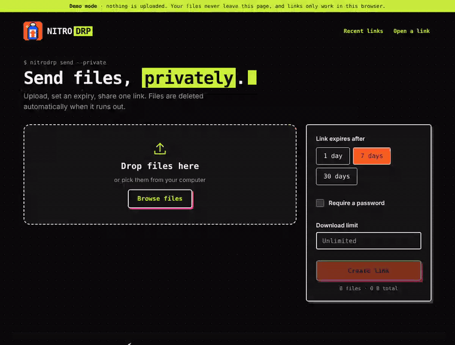
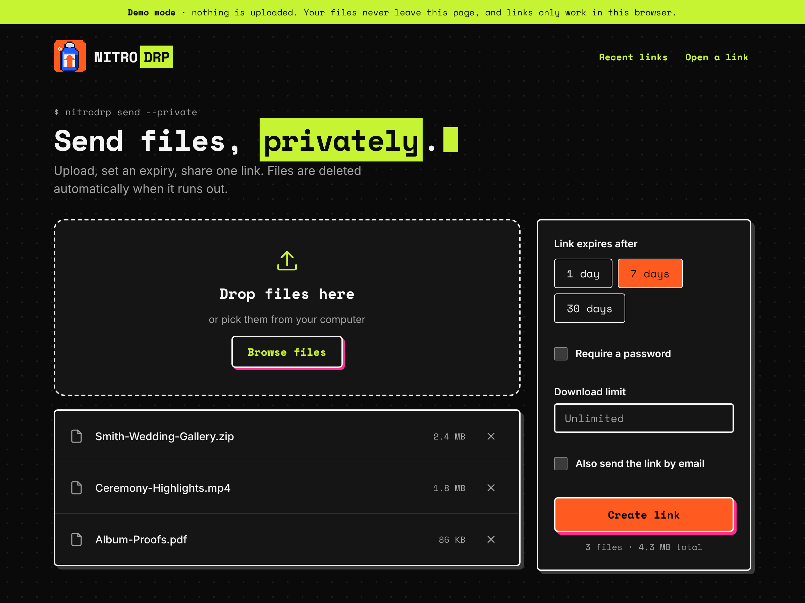
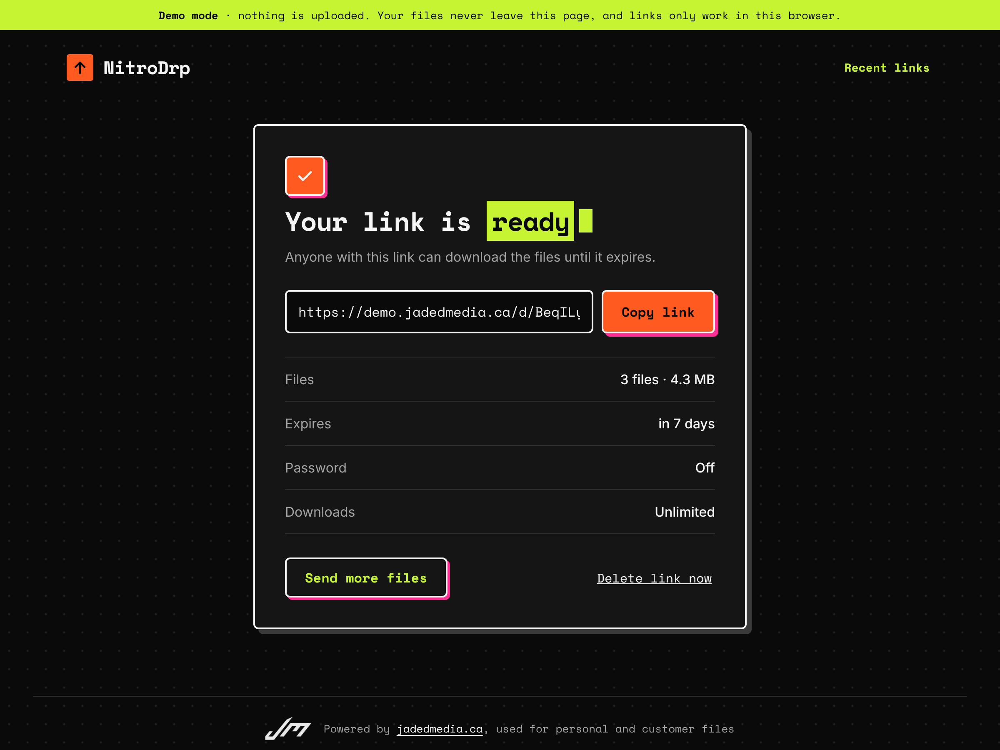
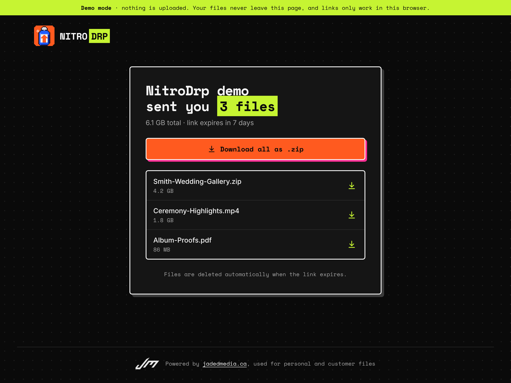
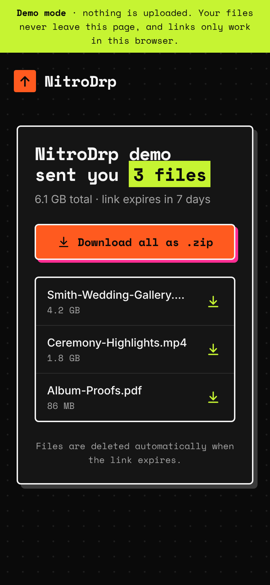
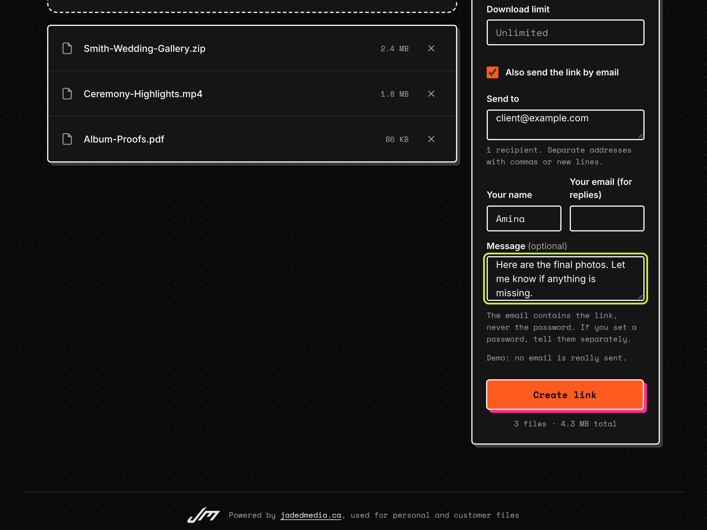

# NitroDrp

[](https://github.com/FunmbiO/NitroDrp/actions/workflows/ci.yml)
[](LICENSE)

**A private, self-hosted file-transfer service, built to replace a WeTransfer subscription.** Resumable multi-GB
uploads straight to S3, expiring links with an optional password and download limit, passkey sign-in, email
delivery, an installable phone app, and the whole AWS setup as Terraform. It runs for real at
[drop.jadedmedia.ca](https://drop.jadedmedia.ca).

**[Try the live demo](https://demo.jadedmedia.ca)** · [Architecture](docs/ARCHITECTURE.md) · [Security](docs/SECURITY.md) · [Docs](#docs)



The demo runs its whole backend inside your browser, so nothing you pick is uploaded
([how the demo works](docs/DEMO.md)).

## Built like production

- **Correct under concurrency.** Download and email limits are enforced by one conditional DynamoDB write, so
  parallel requests can't exceed them. There's a test that fires 60 at once.
- **Tested at every layer:** 213 API tests (including a software authenticator and about 45 hostile-input
  requests), 97 web tests, browser tests with a virtual Face ID, offline Terraform tests, and CI for all of it.
- **Security you can read about:** passkeys instead of a stored key, rate limits that forged headers can't dodge,
  and every text box validated on the page and again on the server ([details](docs/SECURITY.md)).
- **Reproducible and recoverable:** pinned dependencies and base images, Terraform state in its own versioned
  bucket, and documented steps for deploying it from nothing.

## Decisions and trade-offs

| Decision | Why | What it costs |
|---|---|---|
| **Browsers upload straight to S3**, in 16 MiB parts, using presigned URLs | The server never carries file bytes, so a small server handles multi-GB transfers. S3 itself is the record of progress (`ListParts`), so a closed tab resumes where it stopped. | CORS setup, extra round trips, and a more involved client. |
| **One DynamoDB table**, with atomic conditional writes for counters | No race on download or email limits, no separate expiry job (TTL), and almost no cost at this scale. | Access patterns are fixed up front. The owner's link list sits in one partition, which is fine for one owner and wouldn't be for thousands. |
| **Expiry in three layers:** the API refuses at once, DynamoDB TTL deletes rows, S3 lifecycle rules delete files by key prefix (`d7/`, `d30/`) | Expired links stop working immediately, and data is deleted without a cleanup job. | Lifecycle granularity is whole days. |
| **A small always-on server** (Lightsail and Docker Compose) rather than Lambda or containers on ECS | A predictable US$8 to 12 a month, simple to debug, with AWS services only where they earn their keep. | One instance: rate limits and in-flight sign-in challenges live in memory, and a restart means starting a prompt again. |
| **"Download all" streams a ZIP through the server** (ZIP64, constant memory) | No second copy of every upload sitting in S3. Verified with a 4.8 GB archive. | The server's bandwidth is the limit, so concurrent zips are capped. |
| **Passkeys (WebAuthn) and a signed cookie**, with the access key kept as the recovery secret | Face ID everywhere, nothing phishable, and the same links on every device. Removing a device signs it out. | A single-owner model: there are no user accounts or sharing between people. |
| **The demo is a second implementation of the API, in the browser** | It's free to host, safe to show anyone, and runs the same UI code against the same TypeScript interface. | Two backends to keep in step. Shared types and the same rules in tests do that. |
| **Terraform for AWS, with offline tests** | Everything is reviewable and reproducible, and tests run with no account or credentials. | A mocked provider can't check everything (it can't fake some computed values). |

**Known limits.** One instance, no load testing yet, and no monitoring or alerting beyond a budget alert.

## Features

- **Multi-GB uploads that survive bad connections.** The browser sends 16 MiB parts straight to S3 (the server only
  signs URLs), retries each part, and **resumes after a reload**.
- **Links that expire on their own.** The API refuses expired links at once; DynamoDB TTL and S3 lifecycle rules
  delete the data. No cleanup job.
- **Optional password and download limit**, with the limit enforced by one conditional write, so concurrent
  downloads can't exceed it.
- **"Download all" as a streamed .zip** (ZIP64, flat memory), verified with a 4.8 GB archive.
- **Send the link by email** (optional, Amazon SES): type recipients on the upload page or later, with a note.
  The sender gets the replies, the password is never emailed, and each link has a lifetime cap.
- **A loading screen with some personality.** Instead of a blank page, a pixel racer grabs NOS bottles, boosts, jumps a
  ramp, flips and drifts. It starts before the app's code has arrived, hands over seamlessly to in-app loading states, and
  becomes a still picture if you've asked your device for less motion ([details](docs/DEVELOPMENT.md#the-loading-screen)).
- **A little ceremony when mail goes out.** An F1 car on NOS launches off the grid, leaves a trail of smoke, and "EMAIL
  SENT" appears, before the link page ([details](docs/DEVELOPMENT.md#the-email-sent-animation)). Skippable, and a still
  picture under "reduce motion".
- **Installs on a phone** as a home-screen app (a PWA): full screen, its own icon, opens offline.
- **Optional CloudFront** for downloads, with signed URLs; works fine without it.
- **One app on every device:** sign in with Face ID or a fingerprint (passkeys), and see the same links on your phone
  and laptop ([details](docs/AUTH.md)).
- **Open any link by pasting it:** an "Open a link" page takes a pasted link, or just its code, to the download page.
- **Private by design:** a shared access key to create links, a per-share owner key, PBKDF2 passwords, least-privilege
  AWS access, and rate limits that forged headers can't dodge.
- **Infrastructure as code:** Terraform for everything on AWS, with state in its own versioned bucket and offline
  tests; Docker Compose for the app; reproducible, pinned builds; CI for the API, web, demo, scripts and Terraform.

**Stack:** ASP.NET Core 10 (minimal APIs) · React + TypeScript (Vite) · Amazon S3 · DynamoDB · SES (optional) · CloudFront
(optional) · Terraform · Docker Compose · Caddy or Cloudflare Tunnel · AWS Lightsail.

## Screens

| Send | Link ready |
|---|---|
|  |  |
| **Receive** | **On a phone** |
|  |  |
| **Email the link (optional)** | |
|  | |

## Docs

| | |
|---|---|
| [Architecture](docs/ARCHITECTURE.md) | Diagram, design decisions, security model and the API |
| [Development](docs/DEVELOPMENT.md) | Repo map, running it locally, every test suite, pinned dependencies |
| [Deploying](docs/DEPLOY.md) | AWS and Terraform, `.env`, the three ways to expose it, CloudFront |
| [Lightsail guide](docs/LIGHTSAIL.md) | Step by step: a small always-on server with automatic HTTPS |
| [Terraform state](docs/TERRAFORM_STATE.md) | Keeping state in S3, moving to it, recovering |
| [Security](docs/SECURITY.md) | Every input, its limits, and the attacks covered and how they're tested |
| [Passkeys](docs/AUTH.md) | Signing in with Face ID or a fingerprint, one app across devices, removing a device |
| [Phone app](docs/PHONE.md) | Installing NitroDrp on a phone's home screen and what to expect |
| [Email](docs/EMAIL.md) | Emailing links with Amazon SES: setup, DKIM records, leaving the sandbox, limits |
| [The demo](docs/DEMO.md) | The in-browser demo, deploying it on Vercel, embedding it |

## Try it

```bash
cd web && npm install
npm run mock     # terminal 1: a mock API with demo links
npm run dev      # terminal 2: the UI on http://localhost:5173
```

or the whole stack locally with S3 and DynamoDB emulators, no AWS account:

```bash
docker compose -f docker-compose.yml -f docker-compose.dev.yml up --build
python3 dev/smoke.py        # in another terminal: checks upload, resume, download, zip and delete end to end
```

Open http://localhost:8080 with the access key `dev-access-key-change-me`.

## Status

Deployed and in daily use on AWS: the API on a Lightsail server behind Caddy, S3 and DynamoDB, CloudFront
downloads, SES email, passkey sign-in, Terraform with remote state. Tested by 213 API tests, 97 web tests, browser
tests of the demo and of passkey sign-in, Terraform and script tests, and an end-to-end smoke test.

The Cloudflare Tunnel way of exposing it (an alternative to Caddy) is documented but hasn't been run against the
real service.

## Branding

Every page ends with a credit line: the Jaded Media monogram and "Powered by jadedmedia.ca, used for personal and
customer files". To rebrand your own instance, change the text and link in `web/src/components/Footer.tsx` and
replace `web/src/assets/jadedmedia-logo.png` (a white logo on a transparent background suits the dark theme).

## License

The code is [MIT](LICENSE). The Jaded Media logo and name are **not** covered by it ([details](web/src/assets/NOTICE.md)). Third-party software and its licenses: [THIRD_PARTY.md](THIRD_PARTY.md).
