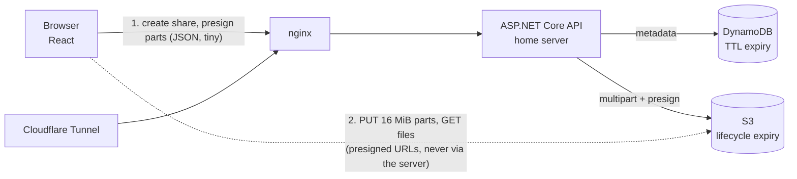

# NitroDrp

```
$ nitrodrp send --private
```

A private, self-hosted file transfer app: upload big files, get an unguessable link, set an expiry, an optional password and a download limit. Built to replace a WeTransfer subscription, and as a portfolio project.

**Stack:** ASP.NET Core 10 (minimal APIs) · React + TypeScript (Vite) · Amazon S3 · DynamoDB · Terraform · Docker Compose · Cloudflare Tunnel.

## How it works



Design decisions worth knowing:

- **File bytes never touch the home server.** The API only signs URLs. Uploads are S3 multipart (16 MiB parts, 4 in flight, per-part retry with backoff and a fresh URL), so multi-GB files survive flaky connections and the home uplink isn't the bottleneck.
- **Uploads resume after a reload.** The browser remembers the unfinished share; re-picking the same files (matched on name, size and modified time) turns the button into "Resume upload". The API asks S3 which parts it holds (`ListParts`, so S3 is the source of truth) and only the missing parts are sent. S3 aborts abandoned uploads after 2 days, after which the page says so and starts fresh.
- **Expiry is enforced twice.** The API refuses expired links immediately; DynamoDB TTL deletes the metadata; S3 lifecycle rules (one per expiry choice, keyed on the `d<days>/` key prefix) delete the bytes. No cleanup cron.
- **Download limits are race-free.** The count is a single conditional `UpdateItem` (`downloadCount < downloadLimit`), so concurrent downloads can't exceed the limit. Covered by a concurrency test.
- **Downloads go through CloudFront, not S3.** S3 to CloudFront transfer is free and CloudFront's free tier covers 1 TB/month, so large galleries don't hit S3's $0.09/GB egress. The bucket stays private (origin access control); the API issues short-lived CloudFront signed URLs (RSA key you generate, public half in a Terraform key group). The download filename is part of the signed URL, so it can't be altered. If `CLOUDFRONT_DOMAIN` is unset (local MinIO), the API falls back to S3 presigned URLs behind the same `IDownloadLinkSigner` interface.
- **Two kinds of secret.** A shared *access key* gates creating links (this is a private instance). Each share gets its own 256-bit *owner key* (stored only as a SHA-256 hash) that authorises uploading, finalizing and deleting that share.
- **Passwords** are PBKDF2-SHA256 (210k iterations, per-hash salt). Password-protected links don't reveal their file names until unlocked.
- **Storage and metadata sit behind interfaces** (`IFileStorage`, `IShareStore`). All business rules live in `ShareService` and are tested against in-memory fakes, no AWS needed.
- **Presigned-URL signing identity is least-privilege** (see `infra/terraform/main.tf`).
- **Rate limiting** per client IP, stricter on password attempts. nginx sets `X-Client-IP` from Cloudflare's `CF-Connecting-IP`; the API must only be reachable through nginx.

## Run it locally (no AWS account)

MinIO stands in for S3 and DynamoDB Local for DynamoDB:

```bash
docker compose -f docker-compose.yml -f docker-compose.dev.yml up --build
```

Open http://localhost:8080. The access key is `dev-access-key-change-me`.

Without Docker, run the pieces yourself: start MinIO and DynamoDB Local, then `dotnet run --project api/src/NitroDrp.Api` (port 8080 via `ASPNETCORE_URLS`) and `cd web && npm run dev`.

## Deploy (home server + AWS)

1. Generate the key that signs download URLs. The private key never leaves your server:
   ```bash
   mkdir -p secrets
   openssl genrsa -out secrets/cloudfront-private.pem 2048
   openssl rsa -pubout -in secrets/cloudfront-private.pem -out cf-public.pem
   ```
2. `cd infra/terraform && cp terraform.tfvars.example terraform.tfvars`, edit it (paste `cf-public.pem` into `cloudfront_public_key_pem`), then `terraform init && terraform apply`. This creates the private bucket (CORS, lifecycle rules), the DynamoDB table (TTL), the CloudFront distribution, a least-privilege IAM user and a monthly budget alert. CloudFront takes a few minutes to deploy.
3. In the IAM console, create an access key for `nitrodrp-api`.
4. `cp .env.example .env` and fill it in. `API_KEY` should be a long random string; `CLOUDFRONT_DOMAIN` and `CLOUDFRONT_KEY_PAIR_ID` come from `terraform output`.
5. In Cloudflare Zero Trust, create a tunnel with a public hostname pointing at `http://web:80`, and put its token in `.env` as `TUNNEL_TOKEN`.
6. `docker compose --profile tunnel up -d --build`

Needs Docker Compose 2.24+ (the dev override uses `!reset`).

Make sure `allowed_origins` in Terraform matches your public hostname, otherwise browser uploads fail CORS.

## Tests

```bash
dotnet test api/NitroDrp.sln      # share rules, limits, passwords, expiry, concurrency, resume, CloudFront signatures
cd web && npm test                # chunk uploader (retry, progress, skip-uploaded), file matching, formatting
```

## API

| Method | Path | Auth | Purpose |
|---|---|---|---|
| POST | `/api/shares` | `X-Api-Key` | Create a share, start multipart uploads, get the part plan and owner key |
| GET | `/api/shares/{token}/upload` | `X-Owner-Key` | Per-file completion and the parts S3 already holds, for resuming |
| POST | `/api/shares/{token}/files/{id}/presign` | `X-Owner-Key` | Presigned PUT URLs for part numbers |
| POST | `/api/shares/{token}/files/{id}/complete` | `X-Owner-Key` | Complete a file's multipart upload |
| POST | `/api/shares/{token}/finalize` | `X-Owner-Key` | Verify sizes in S3 and make the link live |
| DELETE | `/api/shares/{token}` | `X-Owner-Key` | Delete files and metadata now |
| GET | `/api/shares/{token}` | none | Public metadata |
| POST | `/api/shares/{token}/unlock` | password | File list for protected links |
| POST | `/api/shares/{token}/download` | password | Count a download, return CloudFront signed URLs (S3 presigned locally) |

## Status and roadmap

Working: everything above. The C# and TypeScript are built and tested, and both Compose stacks render with `docker compose config`. The Dockerfiles, Terraform and the live CloudFront/S3 path have not been run against real services yet, so expect small fixes on first deploy.

Not built yet:

- **"Download all as .zip"**. Right now it downloads the files one after another. Streaming a zip needs a small Lambda or client-side zipping.
- **Instant revocation at the edge.** "Delete link now" removes the S3 object immediately, but CloudFront may serve a cached copy for up to 5 minutes (and only to someone holding an unexpired signed URL, which lasts 15 minutes). An invalidation call on delete would close that gap.
- Password-gate and expired-link screens are functional but weren't in the original design canvas.
