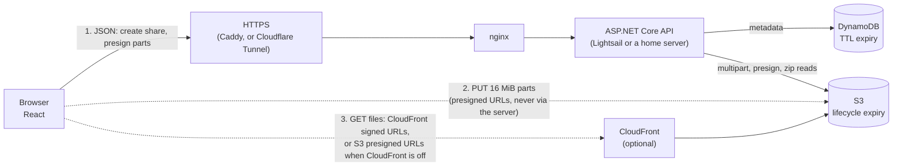

# Architecture

How NitroDrp works and why it's built this way. For running it see [DEVELOPMENT.md](DEVELOPMENT.md); for
deploying it see [DEPLOY.md](DEPLOY.md).

## The pieces

- **Web** (`web/`): React + TypeScript, built with Vite. The same code also runs as a [demo](DEMO.md) with the
  whole backend inside the page.
- **API** (`api/`): ASP.NET Core minimal APIs. It never carries file bytes except when streaming a zip.
- **Storage:** files in S3, link metadata in DynamoDB. Both sit behind interfaces (`IFileStorage`,
  `IShareStore`), and all business rules live in `ShareService`, which is tested against in-memory fakes with no
  AWS involved.
- **Infrastructure** (`infra/terraform/`): the bucket, table, IAM user, optional CloudFront and a budget alert.

## Design decisions

- **File bytes don't touch the server.** The API only signs URLs. Uploads are S3 multipart (16 MiB parts, 4 in
  flight, per-part retry with backoff and a fresh URL), so multi-GB files survive flaky connections and the
  server's own bandwidth isn't the bottleneck.
- **Uploads resume after a reload.** The browser remembers the unfinished share; re-picking the same files
  (matched on name, size and modified time) turns the button into "Resume upload". The API asks S3 which parts it
  holds (`ListParts`, so S3 is the source of truth) and only the missing parts are sent. S3 aborts abandoned
  uploads after 2 days, after which the page says so and starts fresh.
- **Expiry is enforced twice.** The API refuses expired links immediately; DynamoDB TTL deletes the metadata; S3
  lifecycle rules (one per expiry choice, keyed on the `d<days>/` key prefix) delete the bytes. No cleanup cron.
- **Download limits are race-free.** The count is a single conditional `UpdateItem`
  (`downloadCount < downloadLimit`), so concurrent downloads can't exceed the limit. Covered by a concurrency test.
- **CloudFront is optional.** When enabled, downloads go through it: S3 to CloudFront transfer is free and its free
  tier covers 1 TB a month, so large galleries avoid S3's internet egress charge. The bucket stays private
  (origin access control) and the API issues short-lived signed URLs (an RSA key you generate, its public half in a
  Terraform key group). The download filename is part of the signed URL, so it can't be altered. With CloudFront
  off (the `enable_cloudfront` Terraform switch, or a local emulator), the same `IDownloadLinkSigner` interface
  issues plain S3 presigned URLs.
- **"Download all" is a streamed .zip.** The browser navigates to a short-lived HMAC-signed URL (the password was
  checked, and the download counted, by the POST that issued it), and the API zips on the fly: store-only, ZIP64,
  flat memory however large the files are (verified with a 4.8 GB archive). Unlike single files, zip bytes pass
  through the server, read via CloudFront when it's on, and at most 2 zips run at once
  (`Limits:MaxConcurrentZips`). Per-file buttons download directly from storage or the CDN.
- **Deleting a link is immediate at the edge too.** After removing the S3 objects the API sends one CloudFront
  invalidation for the share's folder (`/d7/<token>/*`). It's best effort: if it fails the delete still succeeds,
  and cached copies lapse within the short cache TTL anyway.

## Security model

- **Signing in.** With passkeys on, the owner signs in with Face ID, a fingerprint or a PIN (WebAuthn) and holds a
  signed, HttpOnly, `SameSite=Strict` cookie for 90 days of use. It is valid only while its passkey exists, and
  changing `API_KEY` invalidates every session. See [AUTH.md](AUTH.md).
- **Two kinds of secret.** A shared *access key* (`API_KEY`) gates creating links, because this is a private
  instance. Each share gets its own 256-bit *owner key* (stored only as a SHA-256 hash) that authorises
  uploading, finalizing and deleting that share.
- **Passwords** are PBKDF2-SHA256 (210k iterations, per-hash salt). Password-protected links don't reveal their
  file names until unlocked.
- **Least privilege.** The AWS user the API runs as can only touch this bucket, this table and, if CloudFront is
  on, invalidations on this one distribution (`infra/terraform/main.tf`). It also signs the presigned URLs, so
  browsers can do no more than that.
- **Rate limiting** is per client IP, stricter on password attempts. The API learns the visitor's IP from a
  header that only the proxy directly in front of nginx may set: Cloudflare's `CF-Connecting-IP` for a tunnel, or
  `X-Caddy-Client-IP` for Caddy, which also strips any `CF-Connecting-IP` a visitor sends. The web container
  publishes on `127.0.0.1` only, so nobody can bypass the proxy. `dev/ratelimit-check.py` proves this against a
  live site.
- **Email** (optional) is sent from the server's own domain with the sender as Reply-To; only the owner key can
  trigger it, recipients must be plain addresses, a per-link lifetime cap is enforced by one conditional write, and the
  password is never included ([EMAIL.md](EMAIL.md)). The IAM user may send only from the verified domain.
- **Terraform state** is kept in its own private, versioned, encrypted bucket with locking
  ([TERRAFORM_STATE.md](TERRAFORM_STATE.md)).

## API

| Method | Path | Auth | Purpose |
|---|---|---|---|
| POST | `/api/shares` | `X-Api-Key` | Create a share, start multipart uploads, get the part plan and owner key |
| GET | `/api/shares/{token}/upload` | `X-Owner-Key` | Per-file completion and the parts S3 already holds, for resuming |
| POST | `/api/shares/{token}/files/{id}/presign` | `X-Owner-Key` | Presigned PUT URLs for part numbers |
| POST | `/api/shares/{token}/files/{id}/complete` | `X-Owner-Key` | Complete a file's multipart upload |
| POST | `/api/shares/{token}/finalize` | `X-Owner-Key` | Verify sizes in S3 and make the link live |
| DELETE | `/api/shares/{token}` | `X-Owner-Key` | Delete files and metadata now |
| GET | `/api/shares/{token}` | none | Public metadata |
| GET | `/api/auth/status` | none | Whether passkeys are on, whether you're signed in, whether any exist |
| POST | `/api/auth/register/begin`, `/register/finish` | session or `X-Api-Key` | Enrol a device's passkey |
| POST | `/api/auth/login/begin`, `/login/finish` | none (passkey proves it) | Sign in; sets the session cookie |
| POST | `/api/auth/logout` | none | Clear the session cookie |
| GET, DELETE | `/api/auth/passkeys`, `/api/auth/passkeys/{id}` | session | List and remove enrolled devices |
| GET | `/api/shares` | session or `X-Api-Key` | The owner's live links, newest first, the same on every device |
| GET | `/api/config` | none | Whether email is available, and its limits (the page hides the email options if not) |
| POST | `/api/shares/{token}/email` | `X-Owner-Key` | Email the link to up to 10 addresses; per-recipient results and remaining allowance |
| POST | `/api/shares/{token}/unlock` | password | File list for protected links |
| POST | `/api/shares/{token}/zip-link` | password | Count a download, return a signed URL for the zip |
| GET | `/api/shares/{token}/zip` | signed URL | Stream all files as one .zip |
| POST | `/api/shares/{token}/download` | password | Count a download, return signed download URLs (CloudFront, or S3 presigned) |
